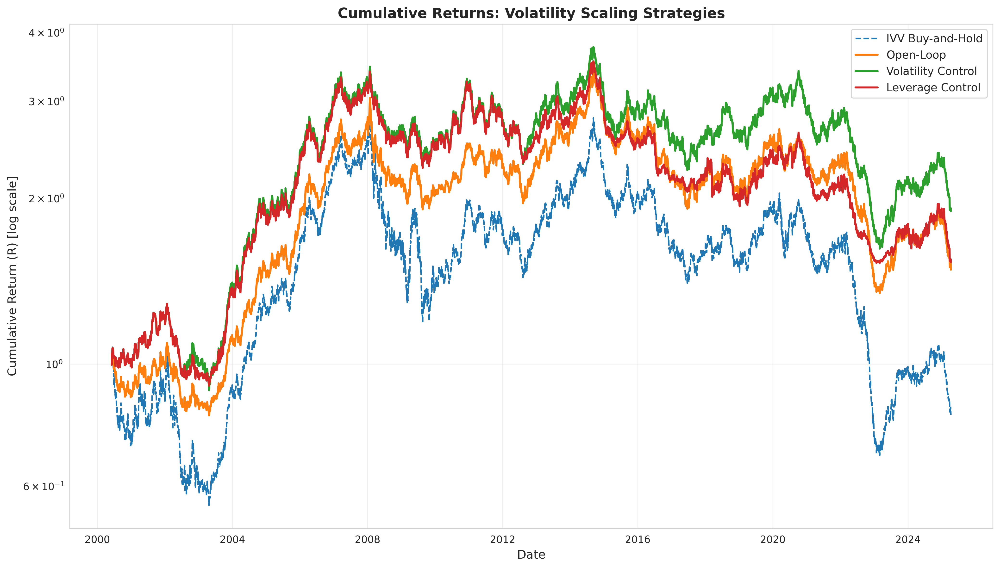
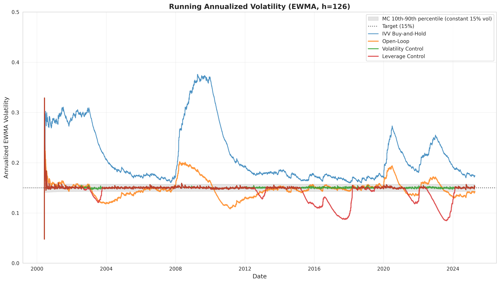
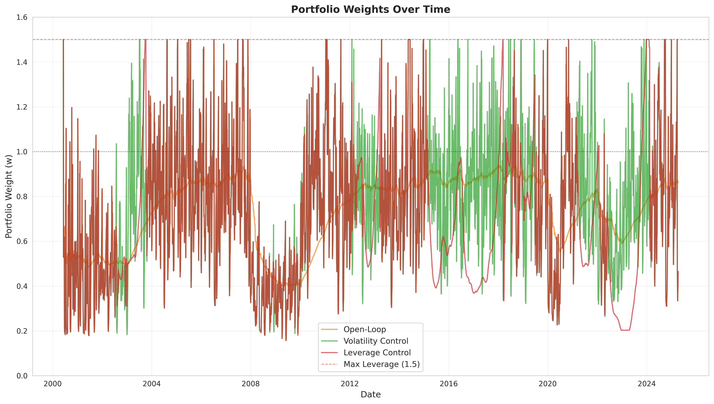
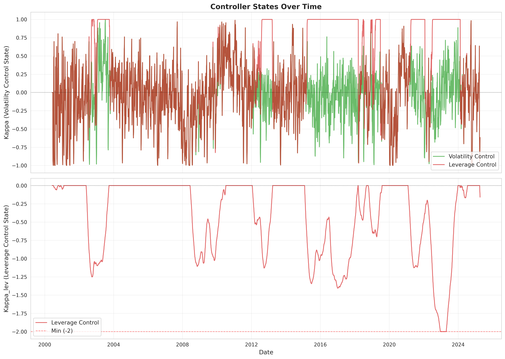
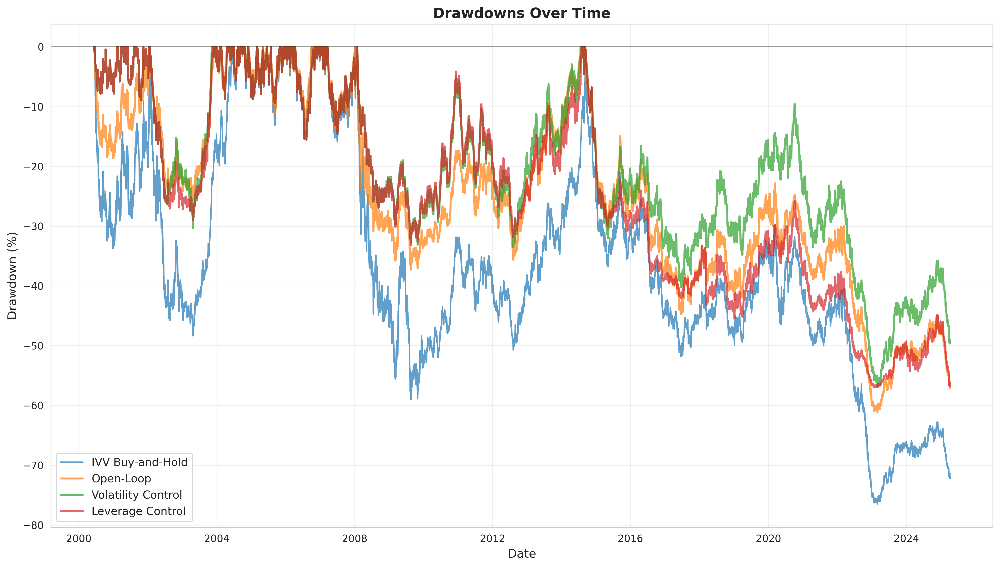

# Volatility Scaling Strategies - Experimental Results

## Overview

This document presents the results of implementing and backtesting four volatility scaling strategies over the period 2000-06-06 to 2025-04-09.

### Data Summary

- **Asset**: IVV (iShares Core S&P 500 ETF)
- **Period**: 2000-06-06 to 2025-04-09
- **Trading Days**: 6482
- **Risk-Free Rate**: Federal Funds Effective Rate (DFF)

### Strategies Tested

1. **IVV Buy-and-Hold**: Baseline strategy (100% invested in IVV)
2. **Open-Loop Volatility Scaling (Algorithm 1)**: Sets leverage proportional to target vol / EWMA vol
3. **Volatility Control (Algorithm 2)**: Proportional feedback controller with log-volatility tracking
4. **Leverage Control (Algorithm 3)**: Combined volatility and leverage control

---

## Table 1: Performance Metrics Comparison

| Strategy | Tracking Error | Ann. Return | Ann. Vol | Sharpe | Max DD |
|----------|----------------|-------------|----------|--------|--------|
| IVV Buy-and-Hold | 6.49% | -0.82% | 21.90% | -0.037 | 76.55% |
| Open-Loop | 1.28% | 1.55% | 14.86% | 0.104 | 61.14% |
| Volatility Control | 0.13% | 2.52% | 15.03% | 0.168 | 56.97% |
| Leverage Control | 0.98% | 1.67% | 14.24% | 0.117 | 56.95% |

---

## Detailed Results

### IVV Buy-and-Hold

- **Volatility Tracking Error**: 6.49%
- **Annualized Return**: -0.82%
- **Annualized Volatility**: 21.90%
- **Sharpe Ratio**: -0.037
- **Maximum Drawdown**: 76.55%

### Open-Loop

- **Volatility Tracking Error**: 1.28%
- **Annualized Return**: 1.55%
- **Annualized Volatility**: 14.86%
- **Sharpe Ratio**: 0.104
- **Maximum Drawdown**: 61.14%

### Volatility Control

- **Volatility Tracking Error**: 0.13%
- **Annualized Return**: 2.52%
- **Annualized Volatility**: 15.03%
- **Sharpe Ratio**: 0.168
- **Maximum Drawdown**: 56.97%

### Leverage Control

- **Volatility Tracking Error**: 0.98%
- **Annualized Return**: 1.67%
- **Annualized Volatility**: 14.24%
- **Sharpe Ratio**: 0.117
- **Maximum Drawdown**: 56.95%

---

## Key Findings

### Volatility Tracking

The **Volatility Control** strategy achieves the lowest tracking error (0.13%), demonstrating superior ability to maintain the 15% target volatility compared to the Open-Loop strategy (1.28%).

### Risk-Adjusted Returns

The **Leverage Control** strategy achieves the highest Sharpe ratio (0.117), outperforming all other strategies on a risk-adjusted basis.

### Drawdown Control

The **Leverage Control** strategy demonstrates the best drawdown management with a maximum drawdown of 56.95%, significantly lower than the IVV buy-and-hold baseline (76.55%).

---

## Figures

### Figure 1: Cumulative Returns

### Figure 2: Running Annualized Volatility

*Gray shaded area shows Monte Carlo 10th-90th percentile confidence band for EWMA estimator under constant 15% volatility assumption.*

### Figure 3: Portfolio Weights Over Time

### Figure 4: Controller States

### Figure 5: Drawdowns Over Time

---

## Methodology Notes

- **EWMA Halflife**: 126 trading days (for volatility estimation)
- **Target Volatility**: 15% annualized
- **Maximum Leverage**: 1.5
- **Warm Start Period**: 10 trading days
- **Controller Parameters**: g=50, theta=0.5, g_ell=20
- **Finite-Sample Correction**: Applied to all EWMA estimates

---

*Results generated by automated experiment suite*
